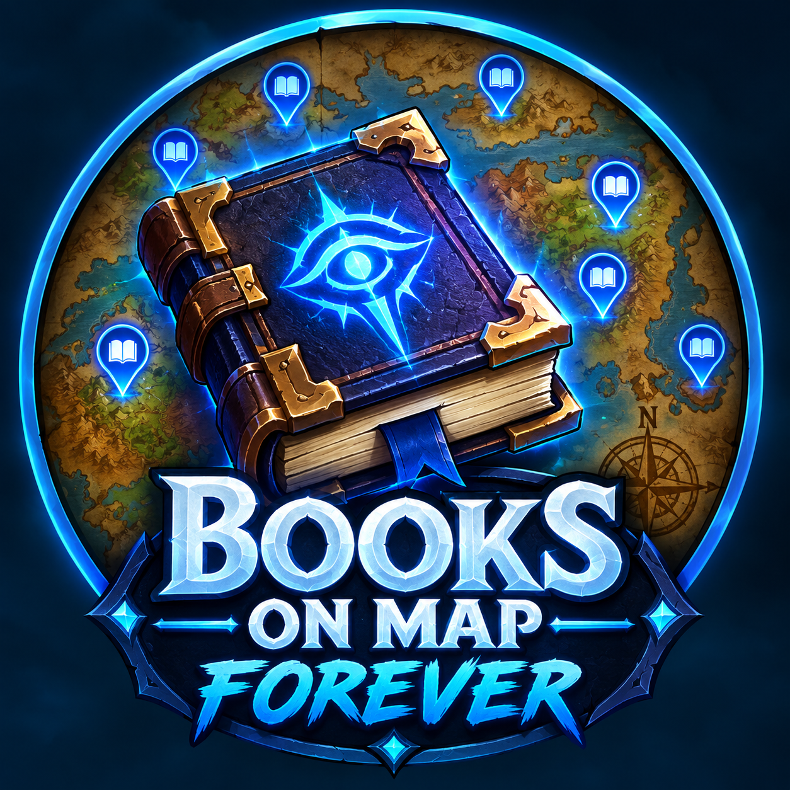

  

<h1 align="center">Books on map (Forever)</h1>

  <strong>Find every library book in WoW Forever.</strong> 
  <em>Trouvez tous les livres de la bibliothèque de WoW Forever.</em>

  <a href="#english">English</a> · <a href="#français">Français</a>

## English

Books on map shows every library book on your world map and minimap, checks them off as you collect them, and tracks your progress toward the library rewards.

### Features

- **Map and minimap:** every book at its exact location.
- **Automatic detection:** books in your bags and books handed in to the library are checked off automatically.
- **Optimized route:** a tracker with an arrow and the distance to your next missing book, with optional Shortest Path guidance or TomTom waypoints.
- **Group mode:** see which books your group members still need, if they use the addon too.
- **Rewards:** follow your progress toward the necklace (10 books), the ring (20 books), and the bow, crest or light (25 books).
- **Collection alerts:** a notification for each book found, and a bigger one at each reward goal.
- **Filters:** hide collected books, or show only the sets for your level.
- **Two languages:** English and French, automatic or chosen in the options.
- **Data broker support:** works with Titan Panel, ChocolateBar, ElvUI, Bazooka and similar addons.

### Installation

Copy the `Books_on_map_Forever` folder into `Interface\AddOns`, then restart the game or reload your interface.

### Mouse controls

| Where | Action | Result |
|---|---|---|
| Map or minimap icon | Shift-click | Mark the book as collected |
| Map or minimap icon | Right-click | Guide with Shortest Path, or add a TomTom waypoint |
| Book list | Click | Open the map at the book's location |
| Book list | Right-click | Guide with Shortest Path, or add a TomTom waypoint |
| Minimap button | Left-click | Open the book list |
| Minimap button | Right-click | Show or hide the map icons |

### Commands

You can use `/bom` or `/books`.

| Command | What it does |
|---|---|
| `/bom` | Open the book list and options |
| `/bom list` | Print every book with its location |
| `/bom next` | Show the nearest missing book |
| `/bom route` | Turn the optimized route on or off |
| `/bom route list` | Print the route in chat |
| `/bom route guide` | Send the route to Shortest Path, or to TomTom if Shortest Path is not available |
| `/bom route tomtom` | Send the route to TomTom |
| `/bom share [group\|guild\|say] [missing]` | Share your progress in chat, and optionally your missing books |
| `/bom done N` / `/bom undo N` | Mark book number N as collected or not collected |
| `/bom toggle` | Show or hide the map icons |
| `/bom minimap` | Show or hide the minimap button |
| `/bom welcome` | Open the welcome page again |
| `/bom bug` | Get the link to report a bug on Discord |
| `/bom reset` | Reset your list |

### Optional addons

- [Shortest Path Forever](https://github.com/cjber/shortest-path-forever) guides you to your books, using the fastest way there. It is used first when installed.
- [TomTom](https://www.curseforge.com/wow/addons/tomtom) adds waypoints.

Books on map works without them.

### Copyright

Copyright (c) 2026 Daeler. All rights reserved. The libraries in the `Libs` folder belong to their respective authors.

---

## Français

Books on map affiche tous les livres de la bibliothèque sur la carte du monde et la minimap, les coche quand vous les ramassez et suit votre progression vers les récompenses de la bibliothèque.

### Fonctionnalités

- **Carte et minimap :** chaque livre à son emplacement exact.
- **Détection automatique :** les livres dans vos sacs et ceux rendus à la bibliothèque sont cochés tout seuls.
- **Route optimisée :** un suivi avec une flèche et la distance jusqu'au prochain livre manquant, avec un guidage Shortest Path ou des points TomTom en option.
- **Mode groupe :** voyez les livres qui manquent aux membres de votre groupe, s'ils utilisent aussi l'addon.
- **Récompenses :** suivez votre progression vers le collier (10 livres), l'anneau (20 livres) et l'arc, l'écu ou la lueur (25 livres).
- **Alertes de collection :** une notification par livre trouvé, et une plus grande à chaque palier de récompense.
- **Filtres :** masquez les livres ramassés ou affichez seulement les séries de votre niveau.
- **Deux langues :** anglais et français, en automatique ou au choix dans les options.
- **Compatible Data Broker :** fonctionne avec Titan Panel, ChocolateBar, ElvUI, Bazooka et les addons similaires.

### Installation

Copiez le dossier `Books_on_map_Forever` dans `Interface\AddOns`, puis relancez le jeu ou rechargez l'interface.

### Commandes à la souris

| Où | Action | Résultat |
|---|---|---|
| Icône sur la carte ou la minimap | Maj+clic | Marquer le livre comme ramassé |
| Icône sur la carte ou la minimap | Clic droit | Guider avec Shortest Path, ou ajouter un point TomTom |
| Liste des livres | Clic | Ouvrir la carte à l'emplacement du livre |
| Liste des livres | Clic droit | Guider avec Shortest Path, ou ajouter un point TomTom |
| Bouton de la minimap | Clic gauche | Ouvrir la liste des livres |
| Bouton de la minimap | Clic droit | Afficher ou masquer les icônes de la carte |

### Commandes

Vous pouvez utiliser `/bom` ou `/books`.

| Commande | Effet |
|---|---|
| `/bom` | Ouvrir la liste des livres et les options |
| `/bom list` | Afficher tous les livres avec leur emplacement |
| `/bom next` | Afficher le livre manquant le plus proche |
| `/bom route` | Activer ou désactiver la route optimisée |
| `/bom route list` | Afficher la route dans le chat |
| `/bom route guide` | Envoyer la route à Shortest Path, ou à TomTom si Shortest Path n'est pas disponible |
| `/bom route tomtom` | Envoyer la route à TomTom |
| `/bom share [group\|guild\|say] [missing]` | Partager votre progression dans le chat, et éventuellement vos livres manquants |
| `/bom done N` / `/bom undo N` | Marquer le livre numéro N comme ramassé ou non ramassé |
| `/bom toggle` | Afficher ou masquer les icônes de la carte |
| `/bom minimap` | Afficher ou masquer le bouton de la minimap |
| `/bom welcome` (ou `/bom bvn`) | Rouvrir la page d'accueil |
| `/bom bug` | Obtenir le lien pour signaler un bug sur Discord |
| `/bom reset` | Réinitialiser votre liste |

### Addons optionnels

- [Shortest Path Forever](https://github.com/cjber/shortest-path-forever) vous guide jusqu'à vos livres par le chemin le plus rapide. Il est utilisé en priorité s'il est installé.
- [TomTom](https://www.curseforge.com/wow/addons/tomtom) ajoute les points de passage.

Books on map fonctionne sans eux.

### Droits d'auteur

Copyright (c) 2026 Daeler. Tous droits réservés. Les bibliothèques du dossier `Libs` appartiennent à leurs auteurs respectifs.
